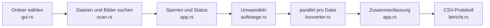
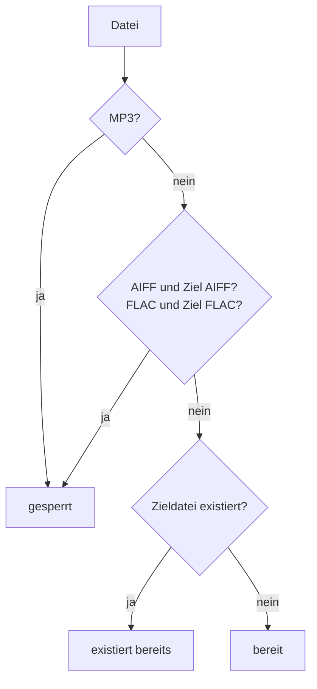
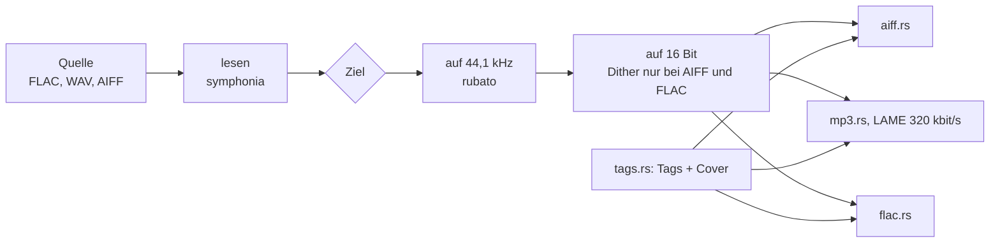

# Funktionen

- Ordner per Knopf (mehrere auf einmal), per Drag & Drop oder als Programm-Argument hinzufügen; Unterordner werden durchsucht
- Quellen: FLAC, WAV, AIFF (MP3 wird gelistet, aber nie umgewandelt)
- Ziel per Dropdown: AIFF 16 Bit 44,1 kHz, MP3 320 kbit/s 44,1 kHz oder FLAC 16 Bit 44,1 kHz
- Tabelle: Häkchen, Nr, Datei, Ordner (kurz, ab Quellordner), Format (z. B. FLAC → AIFF), Status mit Icon
- Kopf-Häkchen wählt alle wählbaren Dateien an oder ab
- Gleicher Ordner = gleiche Zeilenfarbe; flüssig auch bei tausenden Dateien
- Mehrere Dateien gleichzeitig (ein Thread pro CPU-Kern), Abbrechen jederzeit
- Ziel liegt im Ordner der Quelle; Originale und vorhandene Dateien werden nie verändert
- Nach dem Lauf: Zusammenfassung in der Statusleiste, Protokoll als CSV (deutsch: `nr;datei;Ordner/Pfad;von;nach;status`, englisch: `no;file;folder/path;from;to;status`)
- Fenster „Cover“: Ordner ohne Bild und alle gefundenen Bilder; das erste Bild eines Ordners wird in AIFF, MP3 und FLAC eingebettet (größer als 700 x 700 Pixel: auf 700 verkleinert, sonst unverändert)
- Tags (Titel, Künstler, Album, Album-Künstler, Genre, Jahr, Track, Disc, Komponist, BPM, Label) werden übernommen: bei AIFF und MP3 als ID3, bei FLAC als Vorbis-Kommentar
- Sprache Deutsch oder Englisch: Auswahl oben rechts, wird in `sprache.txt` im Einstellungsordner gemerkt (`%APPDATA%\audio-konverter`); beim ersten Start gilt die Systemsprache (`LANG`), sonst Deutsch
- Helles und dunkles Systemthema, Lucide-Icons

## Ablauf

## Sperren

## Umwandlung

