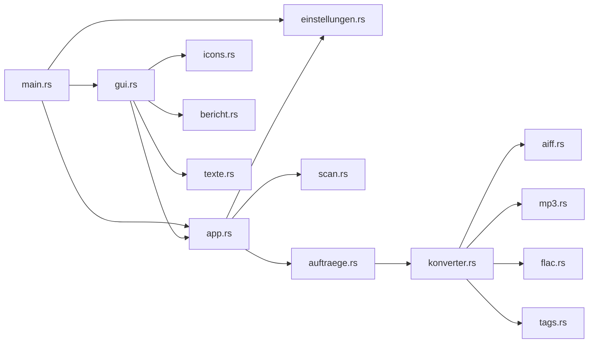

# Audio-Konverter – Wiki

Windows-11-Programm (Rust, egui): wandelt ganze Ordner mit FLAC, WAV, AIFF in AIFF (16 Bit, 44,1 kHz), MP3 (320 kbit/s) oder FLAC (16 Bit, 44,1 kHz) um, für DJ-Player wie den Pioneer XDJ-700. Eigener Konverter, mehrere Dateien gleichzeitig, kein ffmpeg nötig. Oberfläche auf Deutsch und Englisch. Protokoll als CSV.



## Seiten
- [funktionen.md](funktionen.md) – was es kann
- [offen.md](offen.md) – was noch fehlt
- [entscheidungen.md](entscheidungen.md) – warum so
- [review.md](review.md) – Audit und Design-Review
- [bekannte-probleme.md](bekannte-probleme.md) – Fehler und Lösung
- [dj-player.md](dj-player.md) – DJ-Player und unterstützte Formate
- [release-plan.md](release-plan.md) – Plan: Release-Kette Win/macOS/Linux, Code-Prüfung
- [pruefungen.md](pruefungen.md) – Lints, Pre-Commit-Hooks, `cargo deny`
- [diagramme/](diagramme/) – `ablauf.md`, `architektur.md`

## Projektstruktur

```
audio-konverter/
├── Cargo.toml, Cargo.lock
├── assets/icons/     Lucide-Icons (SVG)
├── deny.toml, committed.toml, .pre-commit-config.yaml   Prüfungen
├── .cargo/config.toml, .github/workflows/windows.yml   Build der Windows-.exe
├── src/              main, app, gui, icons, texte, einstellungen, scan, auftraege, konverter, aiff, mp3, flac, tags, bericht
└── wiki/
```

## Start
- `cargo run --release` (wie das Standalone-Programm)
- `cargo test --release` (Tests)
- Fertige Datei: `cargo build --release`

## Regeln
KISS, YAGNI, Deutsch, kurz halten, bevorzugt Mermaid-Diagramme. Nicht coden, wenn „nichts coden“ gesagt wird.
