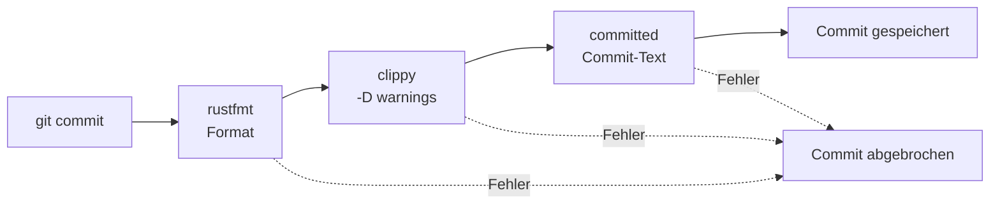

# Prüfungen

Automatische Prüfungen des Codes. Lokal vor jedem Commit (`prek`), später zusätzlich auf GitHub (siehe [release-plan.md](release-plan.md)).



| Werkzeug | Datei | Prüft | Wann |
|---|---|---|---|
| `rustfmt` | – | einheitliche Formatierung | Hook |
| `clippy` | `[lints]` in `Cargo.toml` | Fehler, unnötiger Code; Gruppen `all` + `pedantic`; Zahlen-Casts erlaubt (Audio-Rechnung) | Hook |
| `committed` | `committed.toml` | Commit-Text im Format `feat: …`, `fix: …` (Voraussetzung für semantic-release) | Hook (commit-msg) |
| `cargo-deny` | `deny.toml` | Lizenzen (müssen zu GPL-3.0-or-later passen), bekannte Sicherheitslücken, fremde Quellen | von Hand, später CI |

## Einrichten (Windows)

```
winget install --id j178.Prek
cargo install --locked cargo-deny
prek install
prek run --all-files
```

`prek install` einmal pro Klon. Danach läuft alles bei jedem `git commit`; `prek run --all-files` prüft alles sofort. Hooks überspringen (nur im Notfall): `git commit --no-verify`.

Lizenzen und Lücken prüfen: `cargo deny check`.

## Hinweise

- `deny.toml` ignoriert zwei Meldungen zu `quick-xml` (RUSTSEC-2026-0194/0195): kommt nur unter Linux über `eframe` 0.29 (Bedienungshilfen), das Programm liest kein fremdes XML. Erledigt sich mit einem neueren `eframe`.
- Warnung „LGPL-3.0 veraltet“ kommt von den MP3-Bibliotheken und ist harmlos.
- Nicht übernommen (YAGNI): `typos` (liefert bei deutschen Texten rund 200 Fehlalarme), `rustfmt.toml` (Standard reicht).
- `cargo-machete` (ungenutzte Abhängigkeiten) läuft nur von Hand: `cargo install cargo-machete`, dann `cargo machete`. Stand 22.11.2026: keine ungenutzten Abhängigkeiten gefunden (Version 0.9.1; 0.10.1 braucht neueres Rust).
- Hooks, `deny.toml` und `committed` wurden unter Linux geprüft, auf Windows noch nicht.
