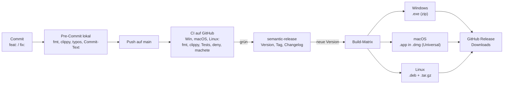

# Plan: Release-Kette und Code-Prüfung

Stand: Historischer Plan, teilweise umgesetzt. Der experimentelle Workflow „Build and release“ baut bei manueller Ausführung oder einem `v*`-Tag für Windows, Linux und macOS; die Pakete für Windows und macOS müssen noch auf GitHub und den Zielsystemen geprüft werden. Er nutzt Ubuntu 24.04 statt 22.04 und erstellt Releases aus vorhandenen Tags. CI läuft bei Pull Requests und Pushes auf `main`; semantic-release ist weiterhin nicht umgesetzt. Die folgenden Abschnitte beschreiben den ursprünglichen Plan, nicht den aktuellen Stand; siehe README für die tatsächliche Nutzung.

## Überblick

## 1. Versionen mit semantic-release

| Punkt | Festlegung |
|---|---|
| Werkzeug | `semantic-release` mit Plugin `@semantic-release-cargo/semantic-release-cargo`, läuft nur auf GitHub (Node.js wird lokal nicht gebraucht) |
| Auslöser | jeder Push auf `main`, nachdem die CI grün ist |
| Version | aus den Commit-Texten (Conventional Commits): `fix:` → 0.4.**1**, `feat:` → 0.**5**.0, `feat!:` oder `BREAKING CHANGE:` → **1**.0.0. Andere (`docs:`, `chore:`, `ci:`) → kein Release |
| Was es tut | nächste Version berechnen, in `Cargo.toml` eintragen, `CHANGELOG.md` schreiben, Tag `vX.Y.Z` und GitHub-Release anlegen |
| Was es nicht tut | auf crates.io veröffentlichen (abschalten, das Programm ist keine Bibliothek) |
| Konfiguration | `.releaserc.json`: Plugins commit-analyzer, release-notes-generator, changelog, semantic-release-cargo, git, github |
| Commit-Texte | Präfix Englisch, Rest darf Deutsch sein, z. B. `feat: FLAC fest auf 16 Bit` |

Danach werden die Plattform-Dateien gebaut und an dasselbe Release gehängt. Der bisherige Workflow `windows.yml` geht darin auf.

Alternative ohne Node.js: `release-plz` (reines Rust, öffnet erst einen Release-PR). Nicht gewählt, weil semantic-release gewünscht ist und ohne Zwischen-PR auskommt.

## 2. Plattformen

| | Windows | macOS | Linux (Mint) |
|---|---|---|---|
| Runner | `windows-latest` | `macos-latest` (Apple Silicon) | `ubuntu-22.04` |
| Ziel | `x86_64-pc-windows-msvc` | `aarch64-apple-darwin` + `x86_64-apple-darwin`, mit `lipo` zu einer Universal-Datei | `x86_64-unknown-linux-gnu` |
| Paket | `.exe` im `.zip` (C-Laufzeit eingebaut, schon da) | `.app` in `.dmg` (Icon, Doppelklick, kein Terminal) | `.deb` (Doppelklick in Mint) und `.tar.gz` |
| Werkzeug | keins nötig | `cargo-packager` | `cargo-packager` |
| Signatur | keine; Warnung „Windows hat den PC geschützt“ → „Trotzdem ausführen“ | Ad-hoc-Signatur (kostenlos); Nutzer öffnet einmal per Rechtsklick → Öffnen. Notarisierung (99 $/Jahr) erst bei Bedarf | nicht nötig |
| Besonderheit | – | rfd nutzt native Dialoge | Bau auf Ubuntu 22.04, damit die Datei auch auf Mint 21.x läuft (Runner voraussichtlich bis 2027, dann 24.04); Build braucht GTK3- und X11/Wayland-Pakete |
| Später möglich | Windows auf ARM (`windows-11-arm`), Installer (NSIS/MSI) | Notarisierung | AppImage |

`cargo-packager` erzeugt `.app`/`.dmg`, `.deb`, AppImage und Windows-Installer mit einer Konfiguration in `Cargo.toml`. `cargo-dist` wurde verworfen: es ist auf Kommandozeilen-Programme ausgelegt und baut keine `.app`.

## 3. Statische Code-Prüfung

Drei Stufen: schnell lokal, vollständig in der CI, regelmäßig für neue Sicherheitslücken.

| Werkzeug | Prüft | Pre-Commit | CI (jeder Push) | wöchentlich |
|---|---|---|---|---|
| `rustfmt` | Formatierung | ✓ | ✓ | |
| `clippy` (`-D warnings`) | Fehler, unnötiger Code, Performance-Hinweise | ✓ | ✓ (alle 3 Systeme) | |
| `committed` | Commit-Text im Conventional-Commits-Format (sonst kann semantic-release keine Version bestimmen) | ✓ (commit-msg) | ✓ | |
| `cargo test --release` | Tests | | ✓ (alle 3 Systeme) | |
| `cargo-deny` | Lizenzen, bekannte Lücken (RustSec), doppelte Versionen, fremde Quellen | | ✓ | ✓ |
| `cargo-machete` | ungenutzte Abhängigkeiten | | ✓ | |
| Dependabot | Updates für Bibliotheken und Actions | | | ✓ |

- **Hook-Werkzeug:** `prek` (Rust, eine Datei, liest `.pre-commit-config.yaml`, kein Python). Alternative: `lefthook`.
- **Lints zentral in `Cargo.toml`** (`[lints.clippy]`): Gruppe `pedantic` als Warnung, einzelne laute Lints abschalten; `undocumented_unsafe_blocks` an.
- **Pre-Commit bleibt unter ca. 30 s:** Tests und `cargo-deny` laufen nur in der CI.
- **Nicht übernommen (YAGNI):** Miri, Fuzzing, `cargo-geiger`, `cargo-semver-checks` (nur für Bibliotheken sinnvoll).

Bekannte Funde vorab:
- `src/mp3.rs` nutzt zweimal `unsafe { set_len }`. Geprüft: `mp3lame-encoder` 0.1.5 bietet keine sichere Variante, die Stellen tragen `SAFETY`-Kommentare.
- Lizenz: GPL-3.0-or-later, `LICENSE` und `license` in `Cargo.toml` sind angelegt (siehe `entscheidungen.md`). `cargo-deny` prüft später, dass alle Abhängigkeiten dazu passen.

## 4. Performance

Die Release-Kette macht das Programm **nicht schneller**. Sie baut mit denselben Einstellungen wie `cargo build --release` (LTO, `codegen-units = 1`, schon in `Cargo.toml`). Was sie bringt: gleiche, geprüfte Builds für alle drei Systeme.

| Option | Wirkung | Empfehlung |
|---|---|---|
| Native Apple-Silicon-Datei (Universal) | auf M-Macs volle Geschwindigkeit statt Rosetta | ja, Teil des Plans |
| PGO (`cargo-pgo`, Profil mit Testdateien) | laut Rust Performance Book oft 10 % und mehr | später, nur nach Messung |
| `target-cpu=native` | nur für den eigenen PC | nein, läuft nicht auf allen PCs |
| `x86-64-v3` | neuere Befehle, Gewinn uneinheitlich, schließt alte CPUs aus | nein |
| `panic = "abort"` | minimal | nein, `catch_unwind` wird gebraucht |
| `mimalloc` | hilft bei vielen kleinen Speicheranforderungen | nein, der Konverter arbeitet blockweise |

MP3 ist der langsamste Teil (60 Tracks: 34 s gegenüber 4 s für AIFF). Die Zeit steckt im C-Encoder LAME, den Rust-Einstellungen kaum beeinflussen.

## Reihenfolge der Umsetzung

1. ~~Lizenz wählen, `LICENSE` anlegen~~ (erledigt: GPL-3.0-or-later)
2. ~~Lints in `Cargo.toml`, `deny.toml`; Funde beheben~~ (erledigt; `rustfmt.toml` und `typos` weggelassen, siehe `pruefungen.md`)
3. ~~`.pre-commit-config.yaml` mit `prek`~~ (erledigt)
4. CI-Workflow (Prüfungen auf 3 Systemen)
5. semantic-release + Build-Matrix + `cargo-packager`
6. Ersten Release auf allen 3 Systemen von Hand prüfen

## Offen für morgen

Stand: Lizenz GPL-3.0-or-later mit Urheber Alexander Singh 2026 ist eingetragen. Die Tests laufen auf dem Windows-PC grün (18 bestanden).

1. Eigene `.exe` mit `cargo build --release` bauen und in den Hauptordner kopieren
2. Zeit für 60 Tracks nach AIFF messen; über 60 s ist ein Problem
3. GitHub-Workflow „Windows-Build“ starten, bis er grün ist
4. Die `.exe` aus den Artifacts auf einem zweiten PC starten
5. Release `v0.4.2` setzen, sobald der Workflow grün ist
6. Versionsnummer in `Cargo.toml` steht noch auf 0.3.0; semantic-release setzt sie später automatisch
7. ~~Testlauf zeigt keine Ausgabe~~ (erledigt: Konsolen-Attribut in `main.rs` gilt nicht mehr für Tests, `cargo test --release` zeigt jetzt die Ergebnisse)
8. Design-Punkte B und C aus `review.md` sind auf später verschoben
9. ~~Lint-Regeln und Pre-Commit-Hooks~~ (erledigt, siehe `pruefungen.md`); als Nächstes Schritt 4: CI-Workflow
